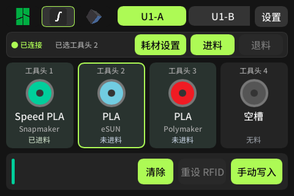
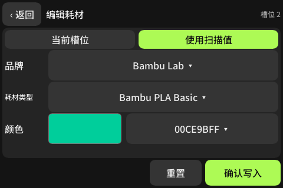

# AMS-Hub

**让耗材切换更简单、更自动化。** AMS-Hub 是以 Snapmaker U1 耗材切换体验为重点的独立社区项目，采用 WT32-SC01 **Plus**（ESP32-S3、16 MiB Flash）+ PN532 SPI，提供中文耗材控制台，并探索配套抽屉式耗材箱。

## 项目目标

AMS-Hub 致力于解决切换耗材丝时浪费的时间和精力——**为什么不让这些更简单、更自动化一些？** 同时，我们计划开发配套的紧凑型耗材干燥箱，**目前尚未实现**。

硬件概念方向是铝合金承重架：上方放置 U1，下方设置两层或三层抽屉式耗材舱，供料管沿架体后侧连接机器供料入口。承重、抽屉运动时的管路余量、干燥密封与加热安全均需工程验证；目前没有发布定型结构或制造图纸。

最终，我们希望你不必再跑到打印机前点击退料，经过漫长的等待后手动卷回耗材、放回干燥箱，再拿出另一卷耗材放入机器，最后逐项设置材料类型、颜色等信息。

我们希望实现的完整体验是：

1. 远程发起退料，无须守在打印机前等待。
2. 退料完成后，耗材自动卷回盒子。
3. 收到提示后，你只需要拿出旧耗材、放入新耗材。
4. 系统自动识别耗材，并向机器写入材料类型、颜色等受支持的信息，轻松完成一次耗材切换。

未来或许还会探索打印中自动切换耗材，沿着类似 AMS 的路径继续发展。

**以上描述的是最终目标，并非当前版本全部具备的功能。** 当前公开版本的能力与验证范围见下文；自动回卷机构、配套干燥箱和打印中自动换料尚未实现。耗材识别与信息写入受标签档案、机型、固件和设备接口支持范围限制。

## 最新固件

仅保留终端最后刷入的 **action-panel · 2026-10-31** 版本：

- [固件文件](releases/latest/AMS-Hub-action-panel-20261031-app.bin)
- [构建与终端验证记录](releases/latest/build-info.json)
- [SHA256 校验值](releases/latest/SHA256SUMS.txt) · [分区表](releases/latest/partitions.csv)

该版本统一了三品牌操作区，包含 U1 耗材设置、进退料确认和阶段显示，以及空槽保护。刷机记录确认已更新终端、配置保留，启动观察无 panic；本轮更新未额外触发打印机物理动作，ACE 进退料未启用。

镜像是 **application-only**，不是从地址 0 烧录的合并镜像。适用 WT32-SC01 Plus / ESP32-S3、16 MiB Flash、7 MiB OTA 应用分区；刷写前核对开发板和分区表。

## 已实现范围

- 拓竹：保留现有 LAN / NFC / 槽位设置路径；中文深色界面、预设和颜色选择、已有 K 校准记录选择。
- U1：支持选择工具头后确认进料、退料，显示执行阶段；机器忙碌、状态未知或条件不满足时禁用操作。退出打印头后仍需手动抽出入口耗材，尚不支持自动回卷。通过 Moonraker `:7125` 查询 `print_task_config`，通过 `SET_PRINT_FILAMENT_CONFIG` 设置工具头身份；查询官方 RFID 锁定状态，不强制覆盖；写入后回读比对。当前 UI 默认写 `Generic` 品牌。
- Anycubic：HTTP `:18910` 本地签名认证、AES-CBC 解密打印机签发的客户端凭据、TLS MQTT `:9883`、`multiColorBox/setInfo`，延迟查询 ACE 状态；只以类型、RGB 比对判定成功。品牌、温度和 K 不作为已同步字段。
- 自动识别流程：扫描耗材 → 取得空槽传感器基线 → 装入一个槽位 → 稳定确认唯一变化 → 自动写入并回读。等待 120 秒、清除扫描、切换品牌/地址、断连或多槽同时变化都会取消本次自动匹配。
- 拓竹保留上游单槽读料事件自动写入；U1 使用入口耗材检测状态；ACE 仅在报告明确的 `loaded` 布尔值或已确认的空槽状态枚举时自动匹配。缺少可信传感器状态会提示手选，不根据颜色/耗材类型猜测槽位。
- Anycubic 适配只适用于具有该 LAN 协议和 ACE 的机型/固件；没有承诺整个品牌所有 FDM 机器兼容。外置料架 `extfilbox` 暂未接入。

主界面隐藏库存操作，已裁剪不需要的网页库存管理入口；RFID 数据库、连接配置与备份保留。跨品牌不转发 Bambu 预设 ID 或 `cali_idx`。

左上角三个品牌官网图标可直接切换品牌；U1 和 ACE 的连接配置分别保存。拓竹卡片显示品牌，支持 4 组 AMS + 上游已有的 8 个 HT 单槽映射，设备条可横向滚动。实际可连接数量仍取决于机器与上游协议能力。

未知 RFID：在屏幕选择耗材预设、颜色、品牌 → 保存到 SD 卡 UID 对应库 → 再次扫描直接识别。不会改写 RFID 标签内容。原有绑定库保留，不需要使用库存网页。

## 交互界面

以下为当前终端版本的 480×320 界面预览，数据为示例。

**U1 耗材与进退料操作**



**耗材编辑**



## 多品牌连接

在设备的连接设置网页验证访问密钥后，配置 **AMS-Hub 多品牌连接** 并重启：

```json
{"brand":"u1","host":"192.168.1.100","api_key":"","ca_pem":"","tls_name":""}
```

Anycubic 使用 `"brand":"anycubic"`，机器需切换 LAN 模式。客户端证书和密钥来自打印机本地握手，不存入仓库。`ca_pem` 为空时使用该 LAN 协议的自签名 TLS 模式；可配置可信 CA 和 `tls_name` 开启服务端校验。仅在可信局域网中使用，配置中的密钥不要提交到 Git。

分别保存一次 U1、Anycubic 的配置即可建立两个连接档案。保存其他品牌配置不会改变当前选中的连接，重启会恢复最后选中的品牌。ACE 的 `ac_empty_status` 默认 `null`；仅在实机确认哪个状态码表示物理空槽后填写，不能直接把所有“非 5”状态当作空槽。ACE 的品牌信息保存在控制台本地并与该槽位读回的类型/颜色关联，不声称机器保存了品牌。

## 构建

当前工作区的本地工具链入口：

```powershell
./scripts/build.ps1 -Mirror
./scripts/package.ps1 -LocalOnly # 仅本地开发打包；当前不代表可对外分发
```

工具链为 `esp1`（Espressif Rust / ESP32-S3）、VS2022 C++ Build Tools、espflash 4.6.0。脚本使用仓库旁 `tools/` 的本地工具链，构建缓存放在本仓库 `target/`。依赖修订由 `core/Cargo.lock` 固定；首次构建成功后应使用 `--locked`。

## 许可与来源

本项目在 SpoolEase 基础上进行了界面和多品牌流程改造，当前仍包含其代码；不隶属于 SpoolEase、Snapmaker 或其他打印机厂商，也不代表其官方产品或获得其背书。来源与版本记录见 [NOTICE.md](NOTICE.md)。

**固件分发许可仍待解决。** 当前使用的 Slint 1.11.0 尚未取得适用的嵌入式商业许可或书面例外授权，其 Royalty-free 路线不覆盖嵌入式，GPLv3 路线与现有 Commons Clause 限制存在兼容性障碍。详见 [第三方许可与发布要求](THIRD-PARTY-NOTICES.md)。

本项目正在规划逐步替换受限依赖、形成独立实现，见 [独立实现迁移路线](INDEPENDENT-IMPLEMENTATION.md)。该计划不改变现有代码的许可，也不表示已经完成权利清理。

本项目沿用上游 [LICENSE.md](LICENSE.md)：**Apache-2.0 + Commons Clause v1.0**。AMS-Hub 自有修改亦按该组合许可提供，另有明确许可声明的第三方内容除外。允许在遵守许可的前提下学习、使用、修改和分发；未经单独授权，不得进行 Commons Clause 所定义的 “Sell”，包括销售软件，以及提供价值全部或主要来自该软件功能的收费产品或服务。

**商业销售及相关收费服务需另行授权；这不等于禁止所有商业场景中的使用。** 本项目维护者只能授权其有权许可的部分，涉及 SpoolEase 上游及其他第三方权利时，还需取得相应权利人的许可。申请途径和范围见 [商业授权说明](COMMERCIAL-LICENSING.md)。由于附加了商业限制，本项目应称为源码公开（source-available），不宣称符合 OSI 开源定义。

字体许可证位于 `core/ui/fonts/OFL.txt`；Slint 和其他依赖按各自许可证使用和分发。原有版权、许可和归属声明均需保留。

协议依据列于 [COMPATIBILITY_RESEARCH.md](COMPATIBILITY_RESEARCH.md)。上游原说明另存为 `README-UPSTREAM.md`；历史 V1 说明见 `README-CN.md`、`CUSTOMIZATION.md`。
